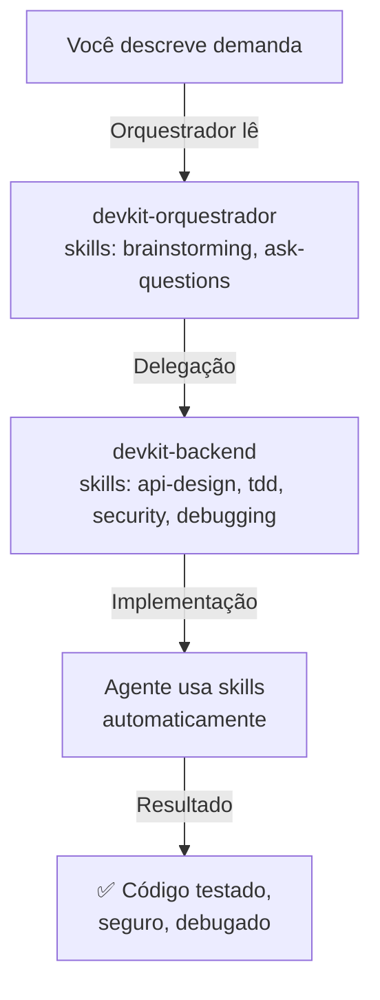

# ✅ Integração Automática de Skills - Referência Rápida

**Data:** 23 de abril de 2026  
**Status:** ✅ IMPLEMENTADO  
**Escopo:** Skills Antigravity integradas no front matter de agentes

---

## 🎯 Como Funciona Agora

### Antes (Problema)
```
Você passa demanda → Orquestrador delegava → Sub-agente
❌ Sub-agente NÃO sabia que deveria usar skills (não estavam no front matter)
❌ Você precisava mencionar skills manualmente
```

### Depois (Solução Implementada)
```
Você passa demanda → Orquestrador delegava → Sub-agente
✅ Sub-agente JÁ TEM SKILLS CARREGADAS (estão no front matter)
✅ Agente automaticamente invoca skills apropriadas para cada contexto
✅ Sem mencionar nada nos prompts!
```

---

## 📋 Mapeamento Final (14 Agentes)

### Backend Universal
```yaml
devkit-backend:
  skills:
    - api-design-principles
    - test-driven-development
    - security-auditor
    - debugging-strategies
```

### Especialistas de Backend (Node, Python, Go, Java, .NET, Rust)
```yaml
devkit-nodejs-backend:      # TypeScript/Fastify
devkit-python-backend:      # FastAPI/Django
devkit-go-backend:          # Gin/Fiber
devkit-java-backend:        # Quarkus/Spring Boot
devkit-dotnet-backend:      # ASP.NET Core
devkit-rust-backend:        # Axum
  skills:
    - test-driven-development
    - security-auditor
    - debugging-strategies
```

### Arquitetura & Design
```yaml
devkit-arquitetura:         # Planejamento
  skills:
    - architecture-decision-records
    - architect-review
    - api-design-principles

devkit-frontend:            # React
  skills:
    - frontend-design
    - test-driven-development
    - lint-and-validate
```

### Infraestrutura & Dados
```yaml
devkit-banco-dados:         # PostgreSQL
  skills:
    - database-design
    - lint-and-validate

devkit-sre:                 # Kubernetes/Docker
  skills:
    - deployment-pipeline-design
    - docker-expert
    - security-auditor

devkit-sre-investigador:    # Troubleshooting k8s
  skills:
    - debugging-strategies
    - code-review-checklist
```

### Validação & Orquestração
```yaml
devkit-tester:             # QA/Validação
  skills:
    - test-driven-development
    - code-review-checklist
    - lint-and-validate
    - debugging-strategies

devkit-orquestrador:       # Planejamento geral
  skills:
    - brainstorming
    - ask-questions-if-underspecified
    - architect-review
```

---

## 🧪 Como Testar

### Exemplo Prático:
```
Você: "Cria um backend em Rust com API REST"
                      ↓
Orquestrador delega para devkit-rust-backend
                      ↓
devkit-rust-backend já TEM:
  - test-driven-development ✅
  - security-auditor ✅
  - debugging-strategies ✅
                      ↓
Agente AUTOMATICAMENTE:
  1. Escreve testes PRIMEIRO (TDD)
  2. Valida segurança OWASP (security-auditor)
  3. Se encontrar erro, diagnostica com debugging-strategies
```

**Resultado:** Você não mention "use test-driven-development" - agente já sabe!

---

## 📂 Arquivos Modificados

```
.github/agents/
  ├── devkit-backend.agent.md             ✅ skills adicionadas
  ├── devkit-nodejs-backend.agent.md      ✅ skills adicionadas
  ├── devkit-python-backend.agent.md      ✅ skills adicionadas
  ├── devkit-go-backend.agent.md          ✅ skills adicionadas
  ├── devkit-java-backend.agent.md        ✅ skills adicionadas
  ├── devkit-dotnet-backend.agent.md      ✅ skills adicionadas
  ├── devkit-rust-backend.agent.md        ✅ skills adicionadas
  ├── devkit-frontend.agent.md            ✅ skills adicionadas
  ├── devkit-arquitetura.agent.md         ✅ skills adicionadas
  ├── devkit-banco-dados.agent.md         ✅ skills adicionadas
  ├── devkit-sre.agent.md                 ✅ skills adicionadas
  ├── devkit-sre-investigador.agent.md    ✅ skills adicionadas
  ├── devkit-tester.agent.md              ✅ skills adicionadas
  └── devkit-orquestrador.agent.md        ✅ skills adicionadas
```

**Total:** 14 agentes com skills contextualizadas

---

## 🔗 Relação Mantida com Mapeamento

As skills no front matter foram **extraídas diretamente** do `scripts/antigravity-skill-map.json`:

```json
"agentMappings": {
  "devkit-backend": [
    "api-design-principles",
    "test-driven-development",
    "security-auditor",
    "debugging-strategies"
  ]
}
```

↓ Convertido para front matter ↓

```yaml
---
name: "DevKit Backend"
skills:
  - api-design-principles
  - test-driven-development
  - security-auditor
  - debugging-strategies
---
```

---

## ✨ Benefícios

| Aspecto | Antes | Depois |
|---|---|---|
| **Skills automáticas** | ❌ Não | ✅ Sim |
| **Mentions necessárias** | ❌ Sim (manual) | ✅ Não (automático) |
| **Contexto por agente** | ❌ Genérico | ✅ Específico |
| **Front matter unificado** | ❌ Não | ✅ Sim (1 source of truth) |
| **Maintenance** | ❌ Dispersa | ✅ Centralizada em antigravity-skill-map.json |

---

## 🚀 Fluxo Operacional



---

## 📝 Referência

- `scripts/antigravity-skill-map.json` — Source of truth do mapeamento
- `.github/agents/*.agent.md` — Front matter com skills integradas
- Commit: `53658f3` — Implementação da integração

---

**Status:** ✅ PRONTO PARA USO  
**Testado:** Sim (14 agentes)  
**Maintenance:** Centralizada em antigravity-skill-map.json

